# SE 4458 Midterm 1 – Group 2: AI Billing Support Assistant

A conversational assistant for mobile subscribers: billing rules and extra-data charges (MCP documentation search), current and
detailed bills, and simulated payments (REST APIs behind an API Gateway). An LLM chooses tools through native function calling;
the **agent** executes them and returns the results to the LLM for a grounded answer.

| # | Mandatory component | Where |
|---|---|---|
| 1 | LLM-powered AI Agent (real tool calling) | `src/agent/` |
| 2 | MCP server for indexed policy documentation (official SDK) | `src/mcp/` |
| 3 | Transactional REST APIs + server database (PostgreSQL) | `src/api/`, `src/billing/`, `migrations/` |
| 4 | API Gateway through which all REST requests are routed | `src/gateway/` |

**Demo video (about 7 min):** [docs/demo-video.mp4](docs/demo-video.mp4) – the deployed gateway (Swagger UI, a protected route returning 401 without a token, the billing API refusing direct calls with 403), the deployed chat UI, the agent scenarios and the confirmed payment as documented with screenshots in this README, and `npm test` (112 tests).

Documents: [Architecture + ER diagram](docs/architecture.md) · [OpenAPI (billing API)](docs/openapi.json) ·
[OpenAPI (agent)](docs/openapi-agent.json) · [Test run evidence](docs/evidence/test-results.txt) ·
[End-to-end transcript (real Gemini + Neon)](docs/evidence/e2e-transcript.md) ·
[Verification summary](docs/evidence/verify-real-summary.txt)

---

## 1. Architecture

```
Client/UI ─► API Gateway :3001 ─► Billing REST API :3000 ─► PostgreSQL
                  │  ▲
                  ▼  │ (agent's REST calls go back through the gateway with the user's JWT)
             AI Agent :3003 ◄──► LLM (OpenAI-compatible, tool calling)
                  │
                  └─ MCP client ─► MCP Server :3002 ─► BM25 index of Mobile_Provider_Billing_Guide.md
```

* The **MCP path is separate from the gateway path**: documentation goes agent → MCP server; every REST operation goes
  agent → gateway → API → database.
* The LLM never calls backends. Tool definitions contain **no subscriber number**: the agent injects the identity from the verified JWT.
* Sequence diagrams (combined scenario, payment confirmation) and the ER diagram are in [docs/architecture.md](docs/architecture.md).

## 2. Run it

Requirements: Node 22+, PostgreSQL (or Docker). Without `DATABASE_URL` the API uses an in-memory store (handy for a quick look; the
deployment uses PostgreSQL).

```bash
cp .env.example .env          # set JWT_SECRET, DEMO_PASSWORD and LLM_API_KEY (and DATABASE_URL for PostgreSQL)
npm install
npm run dev                   # starts API :3000, MCP :3002, gateway :3001, agent+UI :3003
```

Docker (PostgreSQL + all four services):

```bash
docker compose up --build     # needs JWT_SECRET and DEMO_PASSWORD in .env; LLM_API_KEY for the chat
```

| URL | What |
|---|---|
| http://localhost:3003 | Chat UI (sign in, chat, tool trace, payment confirm button) |
| http://localhost:3001/gateway/routes | Gateway route table |
| http://localhost:3001/docs | **Swagger UI of the billing API, served through the gateway** ("Try it out" calls the gateway routes; also `docs/openapi.json`) |
| http://localhost:3000/docs | The same Swagger UI directly on the API service (local convenience) |
| http://localhost:3003/docs | Swagger UI of the agent endpoint (also `docs/openapi-agent.json`) |
| http://localhost:3002/health | MCP server health and index statistics |

### Test data for the instructor

`SEED_DEMO_DATA=true` (default) idempotently seeds, with password `DEMO_PASSWORD` for both subscribers:

| Subscriber | Period | Phone min | Internet MB | Phone | Internet | **Total** |
|---|---|---|---|---|---|---|
| 1001 | Apr 2025 | 1,200 | 35,000 | $10 | $50 + $20 | **$80** |
| 1001 | Sep 2026 | 900 | 18,000 | $0 | $50 | **$50** |
| 1001 | Oct 2026 | 2,300 | 47,000 | $20 | $50 + $30 | **$100** |
| 1002 | Oct 2026 | 500 | 5,000 | $0 | $50 | **$50** |

Reproduce everything with a running stack: `DEMO_PASSWORD=... npm run e2e` prints a markdown transcript of sections 3–7 below.

## 3. REST APIs (`/api/v1`, versioned)

| Operation | Endpoint | Auth | Paging | Notes |
|---|---|---|---|---|
| Add Usage | `POST /api/v1/usage` `{subscriberNo, month, year, usageType: Phone\|Internet}` | JWT | – | One call adds **10 minutes** (Phone) or **1 MB** (Internet) |
| Calculate Bill | `POST /api/v1/bill/calculate` `{subscriberNo, month, year}` | JWT | – | Phone: first 1,000 min free, then $10 per started 1,000-min block. Internet: **$50 up to 20 GB**, then $10 per started 10 GB block. 1 GB = 1,000 MB. Persists the bill |
| Query Bill | `GET /api/v1/bill?subscriberNo&month&year` | none | – | total, paidAmount, remainingBalance, status |
| Query Bill Detailed | `GET /api/v1/bill/detailed?subscriberNo&month&year&page&pageSize` | JWT | **yes** (usage records; `pageSize` ≤ 100) | phone minutes, internet MB/GB, charge breakdown, usage (paged), payments |
| Pay Bill | `POST /api/v1/pay` `{subscriberNo, month, year, amount, transactionId}` | JWT | – | simulated partial/full payment; duplicate `transactionId` → 409; amount > remaining → 422 |
| Login | `POST /api/v1/auth/token` `{subscriberNo, password}` | none | – | returns a 1-hour HS256 JWT |

Error envelope (all services): `{"error": {"code": "...", "message": "...", "requestId?": "..."}}`.
Codes: `VALIDATION_ERROR` 400, `INVALID_AMOUNT` 400, `UNAUTHORIZED` 401, `INVALID_CREDENTIALS` 401, `FORBIDDEN_SUBSCRIBER` 403,
`BILL_NOT_FOUND`/`SUBSCRIBER_NOT_FOUND` 404, `DUPLICATE_TRANSACTION` 409, `PAYMENT_EXCEEDS_BALANCE`/`NO_BALANCE_DUE` 422, `RATE_LIMITED` 429.

API style: REST/JSON exactly as specified in the assignment table; no alternative style was used. Versioning is by URL (`/api/v1`).
Swagger UI is generated from the route schemas, so the document cannot drift from the code.

## 4. Authentication and authorization

* Credentials are stored in PostgreSQL as salted **scrypt** hashes; wrong password and unknown subscriber return the identical 401.
* JWT (HS256, 1 h) with `sub = subscriberNo`. Every protected route verifies it at the **gateway and again at the API**.
* **Authorization:** the authenticated subscriber may only act on their own `subscriberNo` (403 otherwise). Query Bill is public by the
  assignment table; if a token *is* sent it must match the requested subscriber.
* **The agent never trusts a subscriber number from the prompt**: it is not part of any tool schema, and if the model supplies one it is
  discarded and the JWT identity is used (the trace records `model-supplied subscriberNo ignored`).
* Production mode (`NODE_ENV=production`) refuses to start without a `JWT_SECRET` of at least 16 characters.

## 5. API Gateway (`src/gateway/`)

A purpose-built gateway (Fastify) – the assignment accepts "or equivalent" to AWS API Gateway / Azure APIM / Kong. It is the only
public entry point for REST operations and for the agent endpoint, and the agent's own REST calls also go through it.

| Method | Public route | Upstream | Auth | Rate limit (per minute) |
|---|---|---|---|---|
| POST | `/api/v1/auth/token` | api | none | 20 / client IP |
| GET | `/api/v1/bill` | api | none | 60 / client IP |
| GET | `/api/v1/bill/detailed` | api | **JWT** | 60 / subscriber |
| POST | `/api/v1/bill/calculate` | api | **JWT** | 30 / subscriber |
| POST | `/api/v1/usage` | api | **JWT** | 120 / subscriber |
| POST | `/api/v1/pay` | api | **JWT** | 20 / subscriber |
| POST | `/api/v1/agent/chat` | agent | **JWT** | 30 / subscriber |
| GET | `/api/v1/openapi.json` | api (`/docs/json`) | none | 30 / client IP |
| GET | `/docs`, `/docs/*` | api (Swagger UI + assets, same path) | none | 120 and 240 / client IP |

`GET /gateway/routes` returns the same mapping. Authentication is enforced at the edge (before rate limiting) and limits are keyed by the
**verified subscriber identity**, not just the IP. Gateway-level error example (protected route without token):

```json
HTTP/1.1 401   {"error":{"code":"UNAUTHORIZED","message":"A valid Bearer token is required for this route","requestId":"94e9c3c6-…"}}
```
Other gateway errors: `429 RATE_LIMITED` (+`retry-after`), `404 ROUTE_NOT_FOUND`, `502 UPSTREAM_UNAVAILABLE`, `504 UPSTREAM_TIMEOUT`.
Every response carries `x-request-id` and `x-gateway-route`.
**Gateway URL:** local `http://localhost:3001` · cloud: see section 10. Swagger UI: `<gateway URL>/docs`.

## 6. MCP server (`src/mcp/`)

Built with the official `@modelcontextprotocol/sdk`; Streamable HTTP transport (`POST /mcp`, stateless) for deployment, stdio with
`MCP_TRANSPORT=stdio` (e.g. MCP Inspector / desktop clients).

**Tool schema**

```json
{
  "name": "search_billing_documentation",
  "description": "Full-text search over the indexed Mobile Provider Billing Guide ... Returns the most relevant excerpts, each with section id, heading, document id and text.",
  "inputSchema": {
    "type": "object",
    "properties": {
      "query": { "type": "string", "minLength": 2, "maxLength": 500 },
      "maxResults": { "type": "integer", "minimum": 1, "maximum": 5 }
    },
    "required": ["query"]
  },
  "annotations": { "readOnlyHint": true, "idempotentHint": true, "openWorldHint": false }
}
```
Result: `{"query","document","documentId","resultCount","results":[{"reference":"Mobile_Provider_Billing_Guide.md § Internet pricing > 3.2 Additional internet blocks","chunkId","section","sectionId":"3.2","heading":"Additional internet blocks","documentId":"MOB-BILLING-2026-01","score","excerpt"}]}` (`excerpt` is the section text; `sectionId`, `heading`, `documentId` follow the guide's section 9 recommendation)
(or `resultCount: 0` with a note).

**Indexing approach** (`src/mcp/index.ts`): the guide is parsed **once at server start** (never per question) → sections by heading (H1–H4; the heading
path is the section reference) → long sections split on paragraph/list boundaries (≤ 900 chars) → tokenised (lower-case, stop-words, light
stemming, pay/paid/payment normalisation) → inverted index scored with **Okapi BM25** (heading terms weighted ×3, small synonym expansion at
query time, weak matches below 25 % of the best score dropped). Full-text only; no embeddings. The `/health` endpoint reports chunks/terms/build time.

**Three distinct retrieval tests** (also unit-tested in `test/mcp.test.ts`; transcript in `docs/evidence/`):

| Query | Top result |
|---|---|
| `How much does extra internet cost?` | § 3. Extra Data and Extra Phone Charges |
| `Can I pay my bill in parts? partial payment` | § 4. Payments and Partial Payments |
| `What happens if I pay late?` | § 6. Late Payments |

## 7. AI Agent (`src/agent/`)

Flow: user question → **LLM tool selection** → agent executes MCP and/or REST (via gateway) → results back to the LLM → grounded answer with
section references. Provider: any OpenAI-compatible chat-completions API with `tools` (`LLM_API_KEY`, `LLM_API_BASE_URL`, `LLM_MODEL`). There is
**no keyword routing fallback**: without an LLM key the chat endpoint answers `503 LLM_NOT_CONFIGURED`.

| LLM tool | Executed as |
|---|---|
| `search_billing_documentation(query)` | MCP `tools/call` |
| `query_bill(month, year)` | `GET /api/v1/bill` via gateway |
| `query_bill_detailed(month, year, page?, pageSize?)` | `GET /api/v1/bill/detailed` via gateway |
| `pay_bill(month, year, amount?)` | **stages** a payment; `POST /api/v1/pay` runs only after explicit confirmation |

Calculate Bill and Add Usage are provider-side operations and are intentionally not offered to the subscriber-facing assistant.

**Payment confirmation gate (enforced in code, not by prompt):** `pay_bill` only validates against the bill and stages a 5-minute pending
action (agent-generated `AGENT-<uuid>` transaction id). The Pay Bill API is called only when the next message from the *same authenticated
subscriber/conversation* is an explicit confirmation – the UI's **Confirm payment** button (`confirmActionId`) or a typed "yes/confirm/evet/onaylıyorum".
Any other message cancels it. Unit tests prove: no `POST /pay` before confirmation, exactly one after, wrong action id / expired / cancelled /
other-subscriber attempts never pay.

**Example conversations**

| Question | Tools the LLM selected | Scenario |
|---|---|---|
| "How much does extra internet cost?" | `search_billing_documentation` | MCP-only |
| "What is my October bill?" | `query_bill` | REST-only |
| "Why is my October bill higher?" | `query_bill_detailed` (Oct, Sep) + `search_billing_documentation` | combined |
| "Pay my bill" → "Yes, confirm" | `pay_bill` (staged) → confirmation → `POST /api/v1/pay` | payment |

Each response includes `trace[]` (`step, tool, via: MCP|REST, endpoint, input, status, result, durationMs, note`) and `scenario`, derived from the
tools actually executed. The UI renders the trace.

## 8. Tests

```bash
npm test                                   # 112 tests, no cloud, no database, no live LLM
TEST_DATABASE_URL=postgresql://user:pw@localhost:5432/testdb npm test   # + store/seed contracts against real PostgreSQL (125 tests)
npm run build                              # TypeScript strict compile
```
Evidence of a successful run: [docs/evidence/test-results.txt](docs/evidence/test-results.txt) (both modes: 112 and 125 passing).

| REST operation | Success tests | Failure / edge tests |
|---|---|---|
| Add Usage | +10 min Phone, +1 MB Internet | 401, 403 other subscriber, bad type/month, removed `amount` field rejected, unknown subscriber (store) |
| Calculate Bill | Oct 2026 = $20 + $80 breakdown | exactly-at-allowance = $50 only, 401/403, month/year validation, recalculation, unknown subscriber |
| Query Bill | public read incl. `paidAmount` | 404 not calculated, 400 params, token mismatch 403, bad token 401 |
| Query Bill Detailed | breakdown + paged usage (25 records, 3 pages) | 401, 403, 404, `pageSize=101` / `page=0` → 400, page beyond end |
| Pay Bill | partial → PARTIAL, full → PAID | duplicate txn 409, overpay 422, paid bill `NO_BALANCE_DUE`, 401/403, amount ≤0 / 3 decimals / empty txn id, no bill 404, concurrent same txn id (exactly one wins), concurrent overpay |
| Auth | JWT issued | wrong password, unknown subscriber (identical 401), validation |

Also covered: pricing boundaries (1,000/1,001 min, 20,000/20,001/30,000/30,001 MB), MCP chunking/search/server over a real client-server transport,
gateway auth/routing/429/502/404, and the agent end-to-end (real gateway + API + MCP, scripted LLM): the three scenarios, identity override,
the payment gate, malformed tool arguments, runaway loops, 401/503/502.

`scripts/mock-llm.ts` is an OpenAI-compatible **test double** for plumbing checks without an API key; it is not the assistant's LLM.

**Real end-to-end verification** (real LLM + the configured PostgreSQL/Neon): `npm run verify:real` (Windows: double-click `run-all.bat`, which
also installs, builds and tests). It checks `.env`, the database connection, the LLM key and a live chat call, starts the four services on free
ports, runs the demo and writes `docs/evidence/e2e-transcript.md` and `docs/evidence/verify-real-summary.txt` (secrets are redacted).
Between runs, `npm run demo:reset -- --yes` deletes the demo subscribers' payments so the payment scenario can be repeated.

## 9. Demonstration checklist (what to show / where the evidence is)

1. **Three agent scenarios** (MCP-only, REST-only, combined) – UI sample buttons or `npm run e2e`; trace shown in UI.
2. **Three MCP retrieval tests** – section 6 table; `npm run e2e` part 2; `test/mcp.test.ts`.
3. **Protected gateway route** – `GET /api/v1/bill/detailed` → 401 without token, 200 with JWT, 403 for another subscriber (e2e part 1).
4. **Confirmed simulated payment** – "Pay $20 of my October 2026 bill" → staged (Pay API not called) → "Yes, confirm" → remaining balance drops by $20; duplicate txn → 409.
   (Each demo run reduces the demo bill's balance; `npm run demo:reset -- --yes` restores it.)
5. **Unit tests** – `npm test` (no cloud, no database, no live LLM). **Swagger** – `<gateway>/docs`.

### Screenshots (deployed system: Azure Container Apps, real Gemini, Neon PostgreSQL)

**MCP-only scenario** – "How much does extra internet cost?": the LLM selected `search_billing_documentation`; the agent called the MCP server (result carries `document`, `documentId` and section references) and the answer cites `§ 3.2 Additional internet blocks`. No REST call was made (`scenario: mcp-only`).

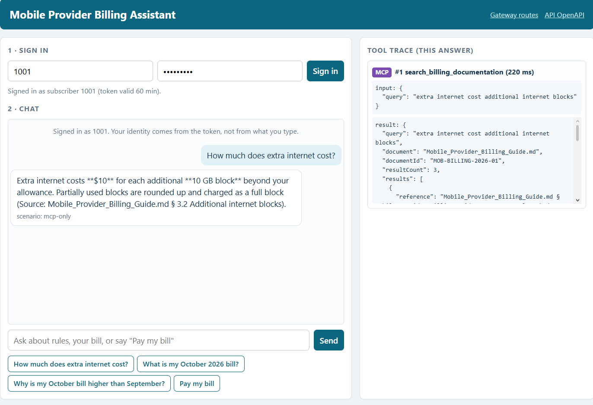

**REST API-only scenario** – "What is my October 2026 bill?": the LLM selected `query_bill`; the agent called `GET /api/v1/bill` through the gateway (200) and the answer is grounded in the returned total, paid amount, remaining balance and status.

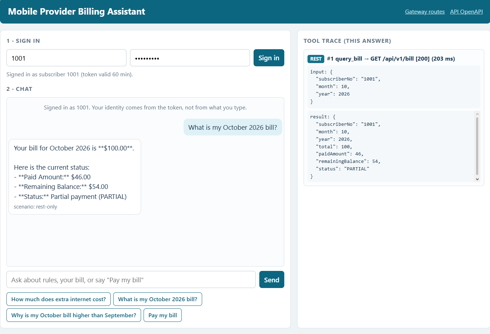

**Combined MCP + REST scenario** – "Why is my October bill higher than September?": the LLM called `query_bill_detailed` twice (September and October, REST via the gateway) and `search_billing_documentation` twice (MCP, internet and phone pricing rules). The answer compares the real usage (900 min / 18 GB → $50 vs 2,300 min / 47 GB → $100) and cites `§ 2.2` and `§ 3.2` (`scenario: combined`).

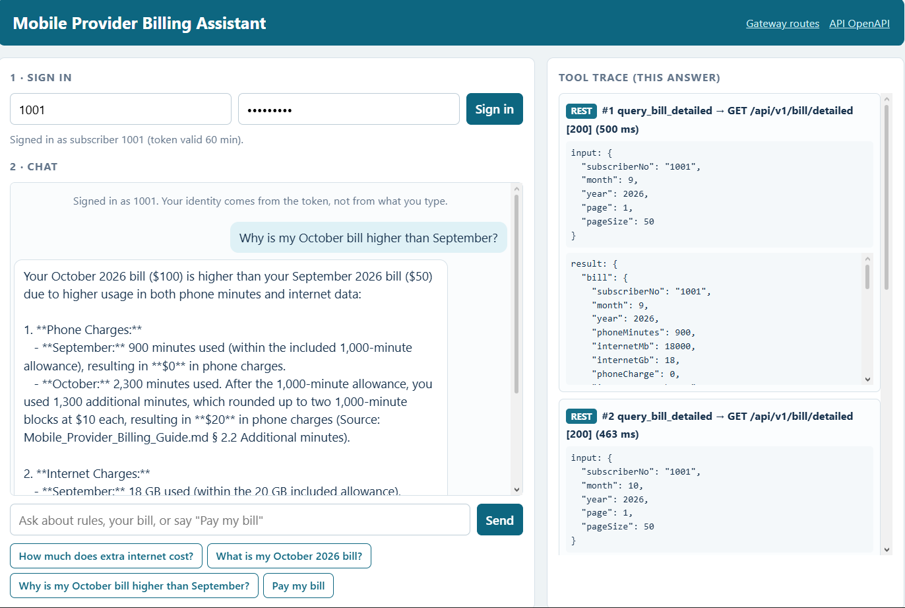
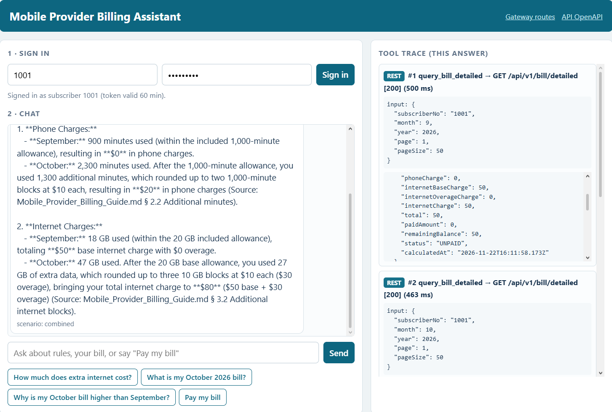
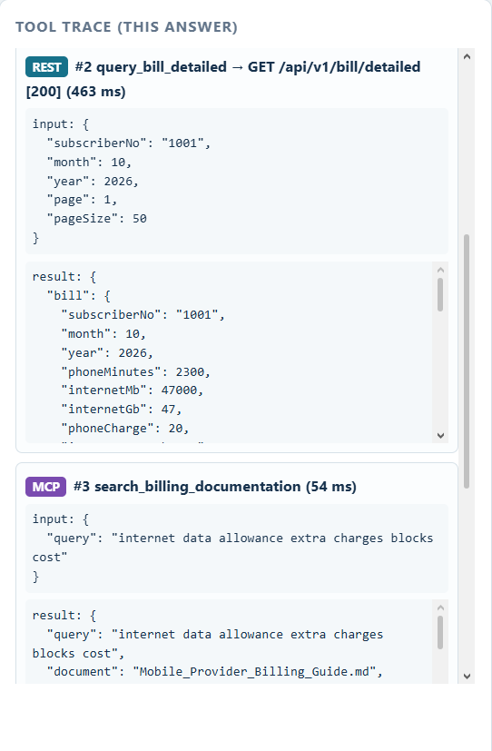
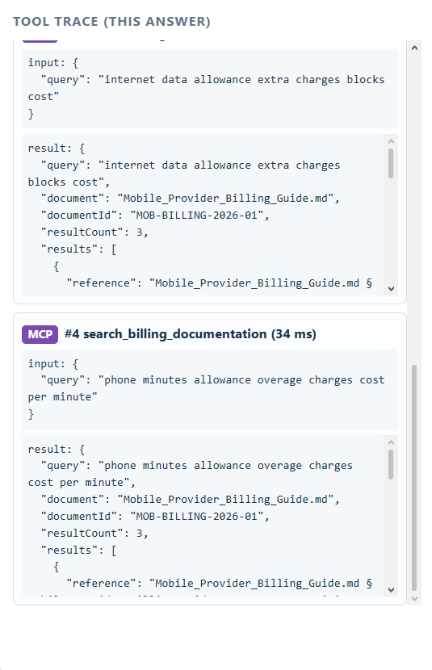

**Three distinct MCP retrieval tests** (each answer cites the guide sections returned by the MCP tool; no REST call):

| Question | MCP query chosen by the LLM | Sections cited |
|---|---|---|
| "Can I pay my bill in parts?" | `pay in parts partial payment billing guide` | § 5.1, § 8.3 |
| "What happens if I pay late?" | `late payment fee consequence late pay` | § 6.1, § 6.2, § 6.3 |
| "How do I dispute a charge?" | `dispute a charge` | § 7.1, § 7.2 |

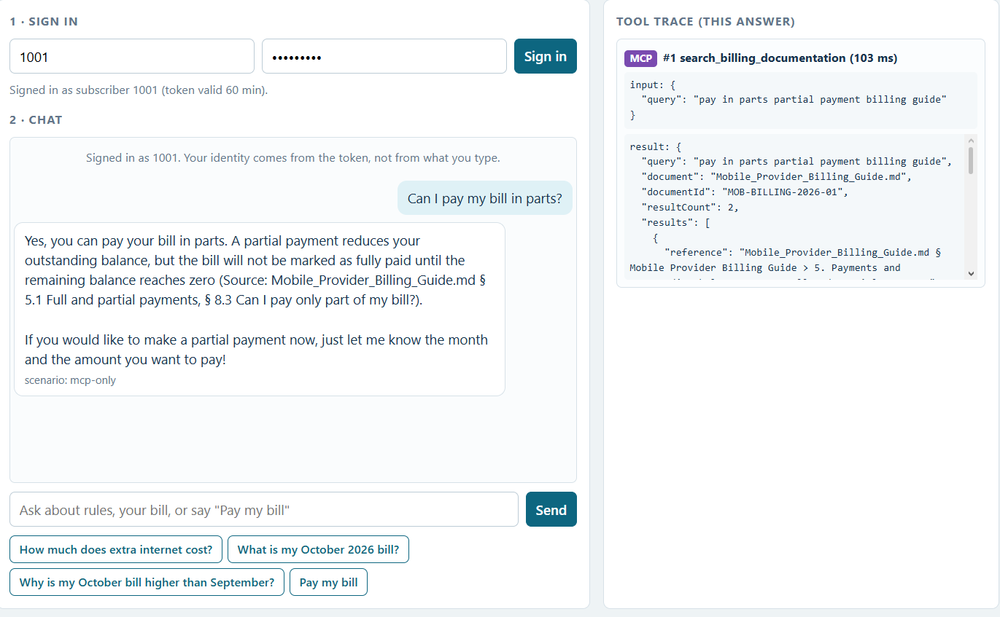
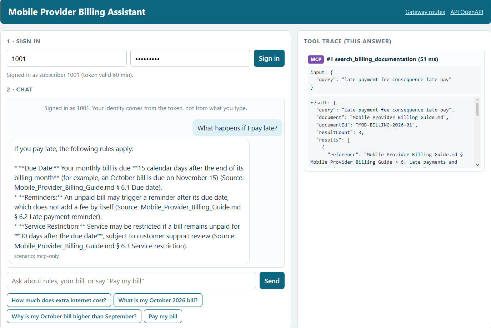
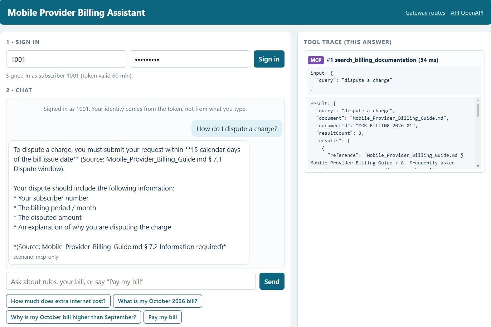

**Protected gateway route** – `GET /api/v1/bill/detailed` on the deployed gateway. Without a token the gateway answers `401 UNAUTHORIZED` (error envelope with `requestId` and the `x-gateway-route` header); with the JWT obtained from `POST /api/v1/auth/token` the same route returns the detailed bill.

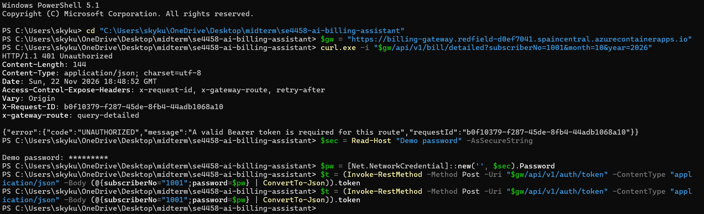
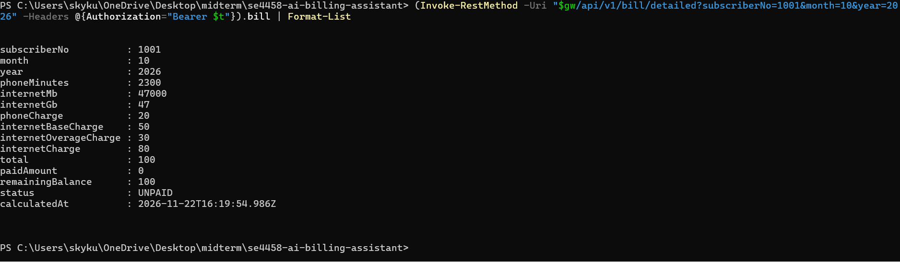

**Confirmed simulated payment** – "Pay $20 of my October 2026 bill": the agent first stages the payment (the trace shows only a pre-check `GET /api/v1/bill`, "Pay Bill NOT called yet", status `CONFIRMATION_REQUIRED`) and the UI asks for explicit confirmation. Only after "Yes, confirm" does the agent call `POST /api/v1/pay` through the gateway with a generated transaction ID: paid $20, remaining balance $80, bill status `PARTIAL`.

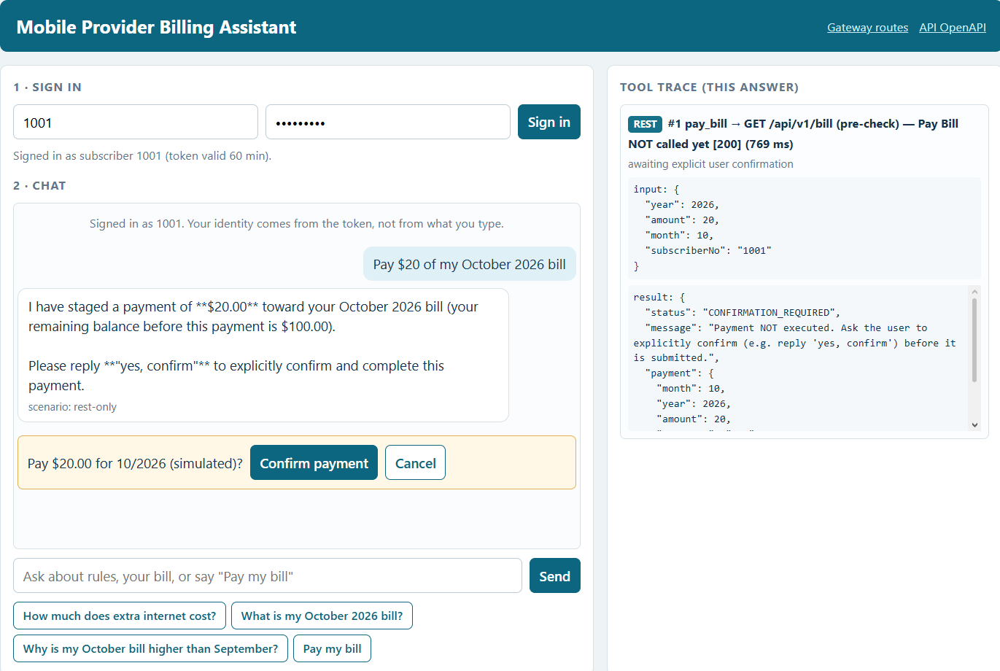
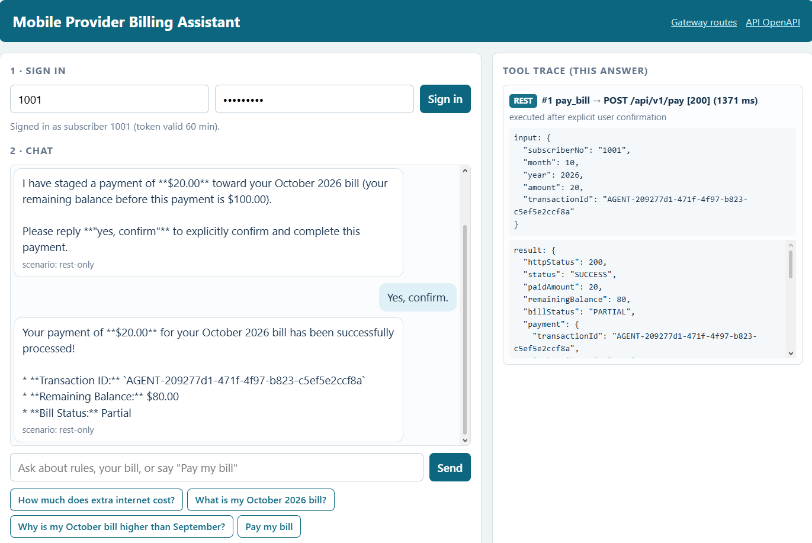

**Unit tests** – `npm test` runs without cloud, database or live LLM: 8 test files, 112 tests passed (agent scenarios, identity checks and the payment confirmation gate included).

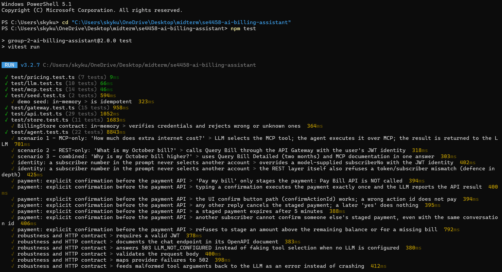
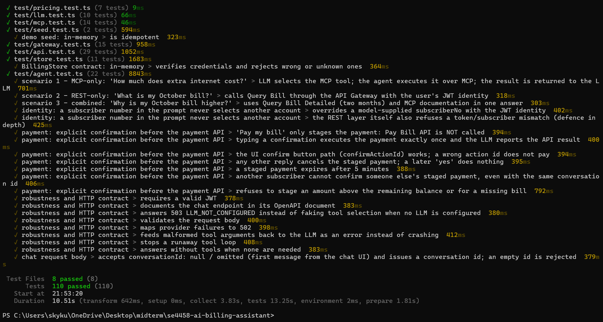

## 10. Cloud deployment

The code ships as one Docker image (`Dockerfile`), four services selected by command, plus a managed PostgreSQL (Neon here; SQLite is not used).
Target: **Azure Container Apps** (image built in Azure with `az acr build`, so no local Docker is needed) + Neon.

**One command** (Windows: double-click `deploy-azure.bat`; needs the Azure CLI and a filled-in `.env`):

```bash
az login
npm run deploy:azure            # options: --resource-group <rg> --location <region> --skip-build --local-build
```

`scripts/deploy-azure.mjs` reads the secrets from `.env` (they become Container Apps secrets and are never printed), reuses the resource group and
environment of an earlier deployment if `billing-api`/`billing-gateway` already exist (otherwise creates group, environment and registry), builds the image,
creates or updates the four apps, wires them together, checks them through their public URLs (health, Swagger UI, 401 without token, login, protected route) and
writes `docs/evidence/deployment.md`.

| App | Ingress | Role / key env vars |
|---|---|---|
| `billing-api` | external address, but **gateway-only**: every request except `/health` must carry the gateway's `x-gateway-key`, otherwise `403 GATEWAY_REQUIRED` | `DATABASE_URL`, `JWT_SECRET`, `DEMO_PASSWORD`, `GATEWAY_SHARED_SECRET` (secrets), `SEED_DEMO_DATA=true`; applies `migrations/*.sql` on start |
| `billing-mcp` | external | `/mcp`, `/health` |
| `billing-gateway` | external | `BILLING_API_URL`, `AGENT_URL`, `JWT_SECRET`, `GATEWAY_SHARED_SECRET` (secrets); serves all REST routes and Swagger UI at `/docs` |
| `billing-agent` | external | `GATEWAY_URL`, `GATEWAY_PUBLIC_URL`, `MCP_URL`, `LLM_API_KEY` (secret), `LLM_MODEL`; its REST calls go through the gateway |

If ACR Tasks is blocked for the subscription (e.g. Azure for Students: `TasksOperationsNotAllowed`), the script automatically builds with local Docker and pushes to the same registry (`--local-build` forces this).

Why the API is not internal: on "express" Container Apps environments (Azure for Students) an internal address presents a TLS certificate that does not match its host name and `allowInsecure` is unsupported, so the gateway cannot reach it (`--internal-api` tries it anyway). To keep "everything goes through the gateway" true, the API accepts requests only with a secret header (`x-gateway-key`, `GATEWAY_SHARED_SECRET`, derived from `JWT_SECRET` by the deploy script) that only the gateway sends; a direct call to the API's public address answers `403 GATEWAY_REQUIRED` (checked by the deploy script and unit-tested). The agent and the UI reach the API only through the gateway.

Each app runs one replica (rate limits and chat sessions are kept in memory). The seed data is created on the first start of the API and is idempotent.

| Service | URL |
|---|---|
| API Gateway | https://billing-gateway.redfield-d0ef7041.spaincentral.azurecontainerapps.io (routes: https://billing-gateway.redfield-d0ef7041.spaincentral.azurecontainerapps.io/gateway/routes) |
| Swagger UI | https://billing-gateway.redfield-d0ef7041.spaincentral.azurecontainerapps.io/docs |
| MCP server | https://billing-mcp.redfield-d0ef7041.spaincentral.azurecontainerapps.io/mcp (health: `/health`) |
| Agent + chat UI | https://billing-agent.redfield-d0ef7041.spaincentral.azurecontainerapps.io |

Deployment checks (health, Swagger with 6 documented paths, 401 without token, login, protected route with JWT, public Query Bill) all passed against these URLs:
[docs/evidence/deployment.md](docs/evidence/deployment.md). Demo login: subscriber `1001` or `1002` with the deployment's `DEMO_PASSWORD`.

## 11. LLM cost and a low-cost / testable approach

* Provider-agnostic (OpenAI-compatible). Low-cost default: **Google Gemini free tier** via its OpenAI-compatible endpoint
  (`LLM_API_BASE_URL=https://generativelanguage.googleapis.com/v1beta/openai`, `LLM_MODEL=gemini-3.5-flash`) – no cost within free-tier limits.
  Alternative: `gpt-4o-mini` (a demo conversation of 2–4 tool rounds is well under one US cent).
* Cost controls in code: at most 6 tool rounds per question, history capped at 16 messages, `temperature 0.1` (the provider default for Gemini 3 models), input ≤ 2,000 chars,
  30 chat requests/minute/subscriber at the gateway.
* Automated tests never use a live LLM (scripted LLM in `test/agent.test.ts`).
* **Free-tier quotas are small and counted per model** (e.g. 20 requests/day for some Gemini models). One tool-using question takes 2–4 LLM calls.
  The client waits and retries per-minute limits (429 with a retry hint) and reports a daily limit immediately; `npm run verify:real` falls back to
  a lighter model for its run when the configured one is exhausted. The submission transcript was produced with `gemini-3.5-flash-lite`.
  Models are retired over time (`gemini-2.5-flash` returned 404 for new users) – if the provider answers 404, pick a current model for `LLM_MODEL`.

## 12. Assumptions and decisions

* **Money:** USD, kept in two decimals and compared in integer cents. Charges are whole dollars by construction. Payments may have at most
  two decimals (`INVALID_AMOUNT` otherwise). No rounding is applied to usage: it is summed as recorded.
* **Internet $50:** read as a monthly package fee covering up to 20 GB, charged on every calculated bill (even with zero usage), plus $10 per
  *started* additional 10 GB block. Phone has no base fee. "Started block" = ceiling; exactly 1,000 min / 20,000 MB / 30,000 MB are not charged for another block.
* **Add Usage** takes no amount (per the table): +10 phone minutes or +1 MB per call. Bulk demo data is seeded directly.
* **Calculate Bill persists a snapshot**; Query Bill/Detailed/Pay read it. Usage added after a calculation appears on the bill only after
  recalculating. Paying/querying a period that was never calculated returns 404 `BILL_NOT_FOUND`. Recalculating keeps existing payments.
* **Query Bill is public** because the assignment table says so; it exposes only totals/status. A presented token is still checked.
* **Payments:** global transaction-id uniqueness (a duplicate from any subscriber is rejected); payment of an already-paid bill → `NO_BALANCE_DUE`;
  payments for one bill are serialised with a row lock in PostgreSQL.
* **Who may add usage / calculate a bill:** the assignment marks Add Usage and Calculate Bill as authenticated, without defining an admin role. Here a subscriber
  may call them only for their own account (the JWT subject must match `subscriberNo`). Provider-side back-office systems and an operator/admin role are out of scope;
  a production system would restrict these two operations to such a role.
* **Gateway-only API:** locally the API accepts any caller (development convenience); when `GATEWAY_SHARED_SECRET` is set (cloud deployment) it accepts only the gateway.
* **Database hosting:** a managed PostgreSQL service (Neon) is used for the cloud deployment instead of a database inside the Azure subscription; connection string and credentials are
  stored as Container Apps secrets and never committed. `docker-compose.yml` provides a local PostgreSQL.
* **Identity:** one subscriber = one login (`subscriberNo` + password). Subscriber management/registration is out of scope; seeded accounts only.
* **Documentation (policy interpretation):** answers cite the section references returned by MCP. The repository's `Mobile_Provider_Billing_Guide.md`
  is the **instructor's official guide** (Document ID `MOB-BILLING-2026-01`); the index is rebuilt from it at every MCP start. Anything the guide does not cover is reported as "not found" rather than guessed.
* **Sample value in the assignment table:** the Query Bill row mentions "Apr 2025 75$". Under the stated pricing every bill is a multiple of $10
  (internet package $50 + $10 blocks, phone $10 blocks), so $75 cannot be produced; it is treated as an illustrative value. The seeded Apr 2025
  bill is $80 (1,200 min = $10; 35 GB = $50 + two started blocks $20, which matches the assignment's own chat example of $70 for 35 GB of internet).
* **Rate limits** are in-memory per gateway instance (not shared across replicas); fine for the assignment, use Redis for multi-instance.
* **Agent sessions** (history, pending payment) are in-memory with a 30-minute TTL; a restart or a second replica loses them (a pending payment then
  simply has to be requested again – it can never be paid unconfirmed).
* **Deployment:** local deployment (Docker Compose) is supported; cloud deployment steps are in section 10.

## 13. Project layout

```
src/api/        Fastify REST API (+Swagger)        src/mcp/      index, MCP server, HTTP/stdio entrypoint
src/billing/    pricing, stores, seed, passwords   src/gateway/  route table, auth/rate-limit/proxy
src/agent/      LLM client, tools, agent loop, sessions, HTTP app
migrations/     idempotent SQL schema              public/       chat UI
scripts/        dev launcher, e2e demo, real-environment verification, demo reset, OpenAPI export, mock LLM (test double)
test/           112 automated tests                  docs/         architecture, OpenAPI, evidence
```
