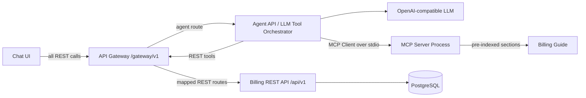
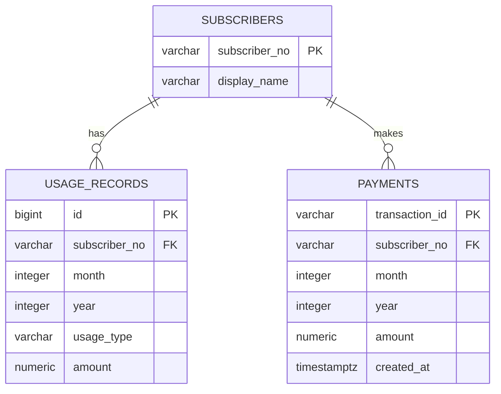

# Architecture

The API starts its MCP server as a child process on the first policy query. It communicates through the MCP SDK's stdio transport. The server indexes guide sections at startup; the agent does not perform policy search itself. The gateway is also used by the Swagger “Try it out” server URL and by the browser UI.

## Entity Relationship Diagram

## Routes

- `GET /health`
- `GET /api/v1/bill`
- `GET /api/v1/bill/detailed` - protected
- `POST /api/v1/bill/calculate` - protected
- `POST /api/v1/usage` - protected
- `POST /api/v1/pay` - protected
- `POST /api/v1/auth/token`
- `POST /api/v1/agent/question` - protected

## Identity Rules

Subscriber numbers in private operations must match the authenticated JWT principal. Payment and usage operations require the protected route; MCP write tools require explicit `confirmed: true`, and the chat UI requires its confirmation checkbox.

## Assumptions

- `1 GB = 1,000 MB`.
- Extra usage uses ceiling rounding for started blocks.
- April 2025 is seeded for the demo subscriber.
- Payments are simulated.
- The in-memory store is a repeatable development mode; PostgreSQL is the documented Docker deployment data store.
