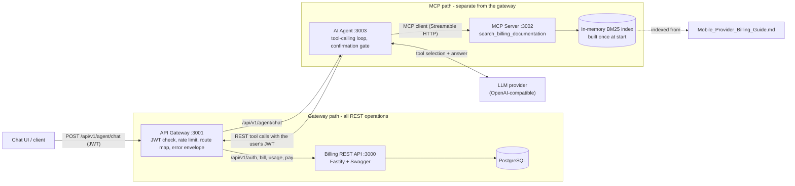
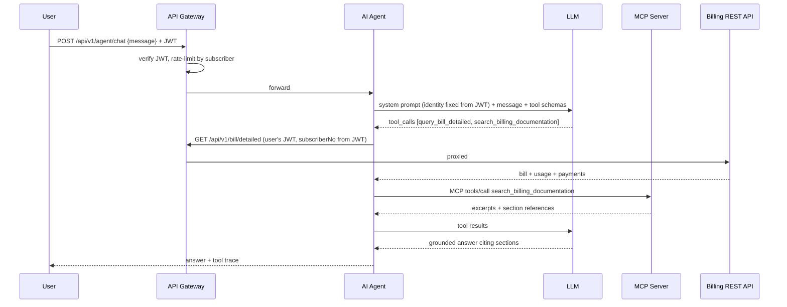
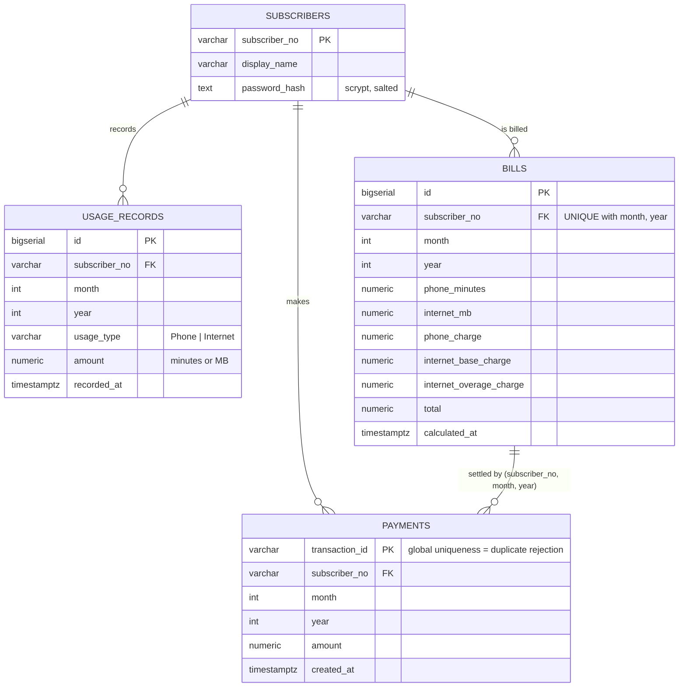

# Architecture

Four independently runnable services plus PostgreSQL. **The LLM never calls a backend itself**: it only chooses tools; the
agent executes them (MCP client for documentation, REST through the API Gateway for live data) and returns the results to the LLM.



## Agent execution workflow



### Payment confirmation gate (enforced in code)

```mermaid
sequenceDiagram
  participant U as User
  participant A as AI Agent
  participant L as LLM
  participant R as Billing REST API (via gateway)
  U->>A: "Pay $20 of my October bill"
  A->>L: message + tools
  L-->>A: tool_call pay_bill {month, year, amount}
  A->>R: GET /api/v1/bill (pre-check only)
  A-->>L: {status: CONFIRMATION_REQUIRED}  (Pay Bill NOT called; action staged, 5 min TTL)
  L-->>U: "Please confirm paying $20"
  U->>A: "Yes, confirm" (or UI button with actionId)
  A->>R: POST /api/v1/pay {transactionId: AGENT-uuid}
  R-->>A: SUCCESS, remaining balance
  A->>L: payment result
  L-->>U: "Paid $20, remaining $80"
```

Any other user message cancels the staged payment. Staged actions are keyed by authenticated subscriber + conversation id, so another
user cannot confirm them.

## Entity relationship diagram


