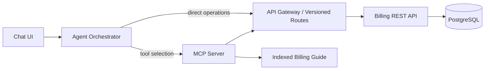
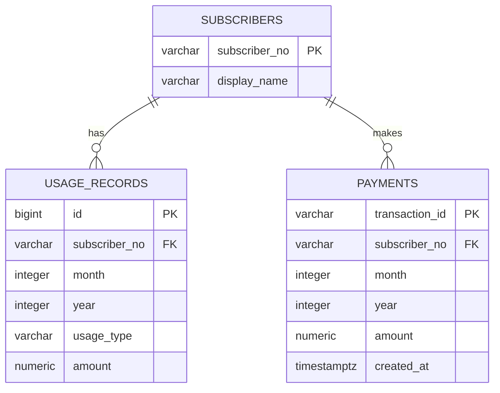

# Architecture

## Entity Relationship Diagram

## Routes

- `GET /health`
- `GET /api/v1/bill`
- `GET /api/v1/bill/detailed` - protected
- `POST /api/v1/bill/calculate`
- `POST /api/v1/usage` - protected
- `POST /api/v1/pay` - protected
- `POST /api/v1/auth/token`
- `POST /api/v1/agent/question`

## Identity Rules

Subscriber numbers in private operations must match the authenticated JWT principal. Payment and usage operations require the protected route and explicit confirmation in the agent/MCP flow.

## Assumptions

- `1 GB = 1,000 MB`.
- Extra usage uses ceiling rounding for started blocks.
- April 2025 is seeded for the demo subscriber.
- Payments are simulated.
- The in-memory store is a repeatable development mode; PostgreSQL is the documented Docker deployment data store.
